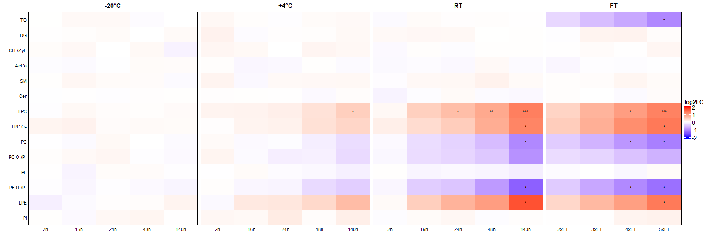

# lipid-stability-heatmap

An R pipeline for **lipid (and metabolite) stability studies**. Samples stored under different temperatures, storage times and freeze-thaw cycles are compared with a −80 °C / 0 h baseline. For every lipid, and for every lipid class, the pipeline computes log2 fold changes, runs non-parametric tests, and draws multi-panel [ComplexHeatmap](https://jokergoo.github.io/ComplexHeatmap-reference/book/) figures.



*Class-summary heatmap (all lipids, uncorrected Dunn's p-values as asterisks) computed from the **fictional** example data shipped in this repository.*

> **Data availability.** The data of the original study cannot be published. All data in this repository are **synthetic**: they were generated by [`scripts/generate_example_data.R`](scripts/generate_example_data.R) with an artificial stability signal and carry no information about real samples or real lipid behaviour. They exist so that the whole workflow can be run and inspected end to end.

## What it does

1. **Reshapes** raw Compound Discoverer exports (one compound per row) into a samples-in-rows matrix, merging ionisation modes, dropping blanks and QC injections, and de-duplicating repeated annotations (`R/combine_compound_discoverer.R`).
2. **Parses lipid classes** from lipid names, including ether lipids (`PC O-`, `PE P-`, ...) and oxidised species (`oxPC`, `oxTG`, ...), with an optional class-merge table and an option to exclude oxidised lipids.
3. **Computes statistics** per lipid and per class: log2 fold change versus baseline, Kruskal-Wallis tests, and Dunn's post-hoc tests, run separately for each comparison group (storage time × temperature, freeze-thaw).
4. **Draws heatmaps** with four side-by-side panels (−20 °C | +4 °C | RT | freeze-thaw), both per lipid and as class summaries, with optional significance asterisks.

## Experimental design assumed

| Group | Conditions | Replicates |
|-------|-----------|-----------|
| Baseline | −80 °C, 0 h | 3 |
| Temperature × time | −20 / +4 / RT °C at 2, 16, 24, 48, 140 h | 3 each |
| Freeze-thaw | −80 °C, 2–5× freeze-thaw cycles | 3 each |

That is 60 samples in 20 conditions. All labels, orders and the expected number of replicates are set in one configuration block at the top of the script, so other designs can be analysed by editing it.

## Repository layout

```
R/
  lipid_stability_analysis.R        main pipeline (statistics + heatmaps)
  combine_compound_discoverer.R     raw Compound Discoverer exports -> samples-in-rows matrix
scripts/
  generate_example_data.R           creates the fictional example exports
data/
  example/                          fictional POS / NEG exports and the combined matrix
example_output/                     what the pipeline produces for the example data
docs/
  METHODOLOGY.md                    statistical details and the three class-summary families
  img/                              figure used in this README
```

## Requirements

- R ≥ 4.3 (developed and tested with R 4.3.1 on Windows 11)
- CRAN packages `readxl`, `openxlsx`, `dplyr`, `tidyr`, `tibble`, `stringr`, `purrr`, `circlize`, `FSA`
- Bioconductor package `ComplexHeatmap`

Missing packages are installed automatically on the first run. On Windows without Rtools, installation uses binary packages only (set automatically by the script).

## Quick start

Clone the repository, open `lipid-stability-heatmap.Rproj` in RStudio (or `cd` into the repository folder), and run:

```bash
Rscript R/lipid_stability_analysis.R
```

This analyses `data/example/example_combined_POS_NEG.xlsx` and writes tables and figures to `output/` (about 20 seconds on the example data). To use other files:

```bash
Rscript R/lipid_stability_analysis.R path/to/input.xlsx path/to/output_dir
```

In RStudio you can instead open `R/lipid_stability_analysis.R` and use *Source*; the paths in the configuration block are then used.

### Regenerating the example data (optional)

```bash
Rscript scripts/generate_example_data.R        # fictional POS / NEG Compound Discoverer-style exports
Rscript R/combine_compound_discoverer.R        # -> data/example/example_combined_POS_NEG.xlsx
Rscript R/lipid_stability_analysis.R           # -> output/
```

All commands are run from the repository root. The data generator uses a fixed random seed, so it reproduces the files already in the repository.

## Using your own data

### 1. Input table

The analysis script expects **one sample per row and one lipid per column**:

| Column | Content |
|--------|---------|
| 1 | Sample name containing `TEMP_TIMEPOINT_REPLICATE`, e.g. `EXAMPLE_-80_0h_1`, `RT_48h_3`, `-80_3xFT_2`. Any prefix or suffix is ignored. |
| 2… | Peak areas, one column per lipid. No missing values and no zeros (the script stops with an error otherwise). |

Lipid names should use common shorthand, e.g. `PC(16:0_18:1)`, `PC(O-34:1)`, `Cer(d18:1_24:0)`, `PE(18:0_9:0(CHO))`. The class is read from the name (see [Lipid class parsing](#lipid-class-parsing)).

### 2. Raw Compound Discoverer exports

If your data are raw Compound Discoverer exports (one compound per row, one `Norm. Area: <raw file> (Fxx)` column per injection), run them through `R/combine_compound_discoverer.R` first. Edit its configuration block (`INPUT_FILES`, `OUTPUT_FILE`, `SAMPLE_PREFIX`, `DESIGN_PAT`); it supports one file or several ionisation modes.

### 3. Configuration

Everything you may want to change is in the configuration block at the top of `R/lipid_stability_analysis.R`:

| Setting | Meaning |
|---------|---------|
| `INPUT_FILE`, `OUTPUT_DIR` | Defaults for the input table and output folder (overridden by command-line arguments) |
| `BASELINE_TEMP`, `BASELINE_TIME` | Baseline condition (default `-80`, `0h`) |
| `TEMP_ORDER`, `TIME_ORDER`, `FT_ORDER` | Temperatures, time points and freeze-thaw labels; also used to build the sample-name regex |
| `N_REPLICATES` | Expected replicates per condition (sanity check) |
| `COMPARISON_GROUPS` | Groups of conditions tested together (Kruskal-Wallis and Dunn's test run per group; the baseline is added automatically) |
| `HEATMAP_PANELS`, `PANEL_DISPLAY_LABELS` | Which conditions go into which heatmap panel, and the panel titles shown (default `-20°C`, `+4°C`, `RT`, `FT`) |
| `CLASS_MERGE_MAP` | Relabels classes after parsing, e.g. `"TG O-" = "TG"` merges ether TGs into TG (use `c()` for no merging) |
| `EXCLUDE_OXIDIZED` | `TRUE` drops all `ox*` lipids before any statistics |
| `HEATMAP_LIMITS`, `SIG_THRESHOLD` | Colour-scale range (log2FC, clipped) and BH significance cut-off |
| `TOP_N_PER_CLASS`, `TOP_N_RANK_GROUP` | Size and ranking group of the top-N class summary |

The defaults reproduce the settings of the original study: five class merges, oxidised lipids excluded.

## Lipid class parsing

`extract_lipid_class()` applies three rules, then the merge table:

1. **Base class**: text before the first `(`, e.g. `PC`, `LPE`, `TG`.
2. **Ether suffix**: if the first `(` is immediately followed by `O-` or `P-`, append ` O-` / ` P-` (`PC O-`, `PE P-`).
3. **Oxidised prefix**: if the name contains `CHO` or `COOH` anywhere, prepend `ox` (`oxPE`, `oxTG`).
4. **`CLASS_MERGE_MAP`**: relabels classes (default: `ZyE` + `ChE` → `ChE/ZyE`, `CerP` → `Cer`, `PC O-` + `PC P-` → `PC O-/P-`, `PE O-` + `PE P-` → `PE O-/P-`, `TG O-` → `TG`).

Ceramide and sphingomyelin `d`/`t`/`m` sphingoid-base forms need no extra handling, because the base letter sits inside the brackets: `Cer(d18:1_24:0)` and `Cer(t18:0_24:0)` both become `Cer`. A class breakdown is printed at start-up so that misassignments are easy to spot.

## Statistics in short

- **Fold change**: log2(median of condition / median of baseline) on raw peak areas per lipid; the median is robust to outliers.
- **Kruskal-Wallis**: on log10 values, separately for each entry of `COMPARISON_GROUPS`, with Benjamini-Hochberg (BH) correction across lipids within each group. A lipid is *significant* if its BH-adjusted p < `SIG_THRESHOLD` in at least one group.
- **Dunn's post-hoc test** (`FSA::dunnTest`): baseline versus every other condition within a group; both BH-adjusted and uncorrected asterisks are stored (`*` p < 0.05, `**` p < 0.01, `***` p < 0.001).
- **Class level**: the same Kruskal-Wallis and Dunn logic on the pooled replicate values of all lipids in a class; the class colour is the median log2FC of its lipids.

See [`docs/METHODOLOGY.md`](docs/METHODOLOGY.md) for details, including the three class-summary families (*all*, *significant*, *top-N*).

## Output

For the example data, `example_output/` contains 13 tables and 15 figures:

```
tables/
  sample_metadata.xlsx
  log10_transformed_data.xlsx
  log2FC_matrix_per_feature.xlsx
  kruskal_wallis_per_feature.xlsx       one column set per comparison group
  dunn_posthoc_per_feature.xlsx         long format, group column included
  log2FC_matrix_per_class[_significant|_top10].xlsx
  kruskal_wallis_per_class[_top10].xlsx
  dunn_posthoc_per_class[_top10].xlsx
  top10_lipids_per_class.xlsx           which lipids were selected for the top-N family
figures/                                each heatmap in three versions:
  heatmap_[all|significant]_features*.pdf          per lipid
  heatmap_class_[all|significant|top10]_features*.pdf   per class
      (no suffix = no asterisks, _significance_BH, _significance_uncorrected)
```

Example result (fictional data): 138 features were merged from the two ionisation modes, 10 oxidised lipids were excluded, leaving 128 lipids in 14 classes; 46 lipids were significant in the Timepoint group and 65 in the Freeze_Thaw group (BH < 0.05). These numbers describe the synthetic signal only.

## Notes

- `FSA::dunnTest()` prints its full result table through R message conditions on every call. The script wraps each call in `suppressMessages()`; without it, a run with hundreds of lipids spends most of its time writing to the console or log file.
- Lipid input order is preserved throughout (no sorting or clustering of rows), so the heatmaps follow the order of columns in the input table, grouped by class.
- Duplicate lipid names are given `a`, `b`, `c`, ... suffixes on the heatmap rows.

## Authors

- Aleš Kvasnička
- Barbora Piskláková

## Citation

If you use this code, please cite it; see [`CITATION.cff`](CITATION.cff) (GitHub's *Cite this repository* button reads it).

## License

Released under the [MIT License](LICENSE).
